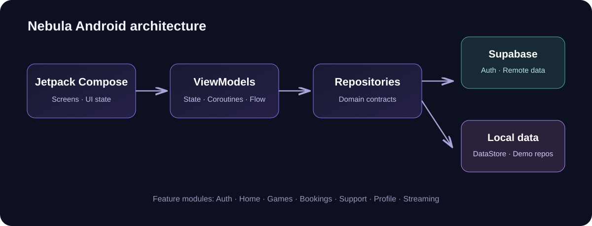

<div align="center">
  
  <br />
  <a href="https://nebulacoreweb.vercel.app/"><strong>Visit Nebula Website</strong></a>
  ·
  <a href="https://github.com/SinghGurjot01-Code/nebulacore/releases">Releases</a>
  ·
  <a href="https://github.com/SinghGurjot01-Code/nebulacore/actions">Builds</a>
</div>

# Nebula for Android

Nebula is a native Android client for a cloud-gaming platform. The app is built with **Kotlin**, **Jetpack Compose** and **Material 3**, with Supabase used for authentication and backend data.

> **Project status:** Alpha. The Android client and its local/demo experiences are under active development. Real cloud-game streaming is not connected yet.

## Links

| Resource | Link |
|---|---|
| Nebula website | [nebulacoreweb.vercel.app](https://nebulacoreweb.vercel.app/) |
| Source code | [GitHub repository](https://github.com/SinghGurjot01-Code/nebulacore) |
| Android releases | [GitHub Releases](https://github.com/SinghGurjot01-Code/nebulacore/releases) |
| Build status and APK artifacts | [GitHub Actions](https://github.com/SinghGurjot01-Code/nebulacore/actions) |

## Features

| Area | Current functionality |
|---|---|
| Authentication | Splash, welcome, registration, login, Google sign-in flow, password reset, email verification state and logout. Supports local demo mode or Supabase when configured. |
| Home | Greeting, notifications, session status, upcoming booking, featured games, recently played and announcements. |
| Games | Demo catalogue, artwork, search, category filters, favourites and game details. |
| Bookings | Plan, date and time selection, review, confirmation, upcoming bookings and booking history. Demo flows are simulated; configured backend operations use Supabase. |
| Support | Support tickets, status, conversations and replies. |
| Profile | Profile details, favourites, gaming history, notification preferences, inbox and app information. |
| Streaming flow | Game launch UI and pre-session checks. The streaming client is currently unavailable; no live stream is claimed. |

## Screens and architecture



The code is organized by feature and responsibility:

- **core**: shared utilities and navigation
- **design**: theme and reusable Compose components
- **domain**: models, validation, repository contracts and game filtering
- **data**: local demo storage and Supabase-backed repositories
- **features**: authentication, home, games, bookings, support, profile and streaming screens
- **di**: application dependency wiring

The Android source lives under `app/src/main/java/com/nebula/app/`; unit tests live under `app/src/test/`.

## Technology

- Kotlin and Jetpack Compose
- Material 3
- MVVM with ViewModels, Coroutines and Flow
- Navigation Compose
- Preferences DataStore
- Coil for image loading
- Supabase Auth and database integration
- Gradle Kotlin DSL

| Android setting | Value |
|---|---|
| Application ID | `com.nebula.app` |
| Minimum SDK | 26 (Android 8.0) |
| Target SDK | 35 |
| Java target | 17 |

## Get the APK

1. Open [GitHub Releases](https://github.com/SinghGurjot01-Code/nebulacore/releases) for versioned builds.
2. Download the APK asset attached to the release.
3. Install it on an Android device running Android 8.0 or later.

For development builds, open [GitHub Actions](https://github.com/SinghGurjot01-Code/nebulacore/actions), select a successful workflow run and download the `nebulacore-debug-apk` artifact. Extract the downloaded ZIP to access the APK.

> Debug artifacts are for testing. They are not the same as a Play Store-signed production release.

## Build locally

### Requirements

- Android Studio (recent stable version)
- JDK 17
- Android SDK Platform 35
- Gradle 8.9 (the workflow configures this version)

### Build commands

From the repository root:

```bash
gradle --no-daemon :app:assembleDebug
gradle --no-daemon :app:testDebugUnitTest
```

The debug APK is generated at:

```
app/build/outputs/apk/debug/
```

## GitHub Actions

The workflow at [`.github/workflows/android.yml`](.github/workflows/android.yml) runs on pushes to `main` or `master`, pull requests, and manual dispatches. It:

1. Sets up JDK 17 and Android SDK 35.
2. Compiles the Kotlin sources.
3. Builds the debug APK.
4. Uploads the APK as `nebulacore-debug-apk`.
5. Runs unit tests and uploads the test report artifact.

Open the [Actions page](https://github.com/SinghGurjot01-Code/nebulacore/actions) to inspect logs and download artifacts.

## Supabase configuration

The app reads its Supabase project URL and public anon/publishable key from Gradle properties:

- `nebula.supabaseUrl`
- `nebula.supabaseAnonKey`

These values are passed into `BuildConfig`. The anon key is a public client key; **never put a Supabase service-role key or Google OAuth client secret in the Android app or repository**.

For Google sign-in and redirect configuration, see [docs/GOOGLE_SIGN_IN_SETUP.md](docs/GOOGLE_SIGN_IN_SETUP.md).

For local demo mode, leave the Supabase Gradle properties empty. Demo data is stored locally or simulated as described in the relevant feature implementation.

## Current limitations and roadmap

- Cloud-game streaming is not implemented. The current streaming client reports that streaming is unavailable.
- Push notifications and a staff/support dashboard are not implemented.
- Some booking, support and profile experiences are demo/local flows; consult the repository implementation before treating them as production backend features.
- Wallet and admin functionality are outside the current app scope.

## Contributing

1. Fork the repository.
2. Create a feature branch.
3. Make focused changes and add or update tests where appropriate.
4. Run the unit tests and build the debug APK.
5. Open a pull request with a clear description and screenshots for UI changes.

## License

No license has been specified in this repository yet. Unless a license is added, standard copyright applies and reuse is not automatically granted.
